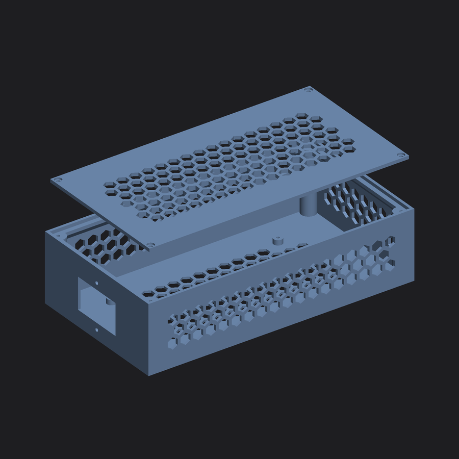
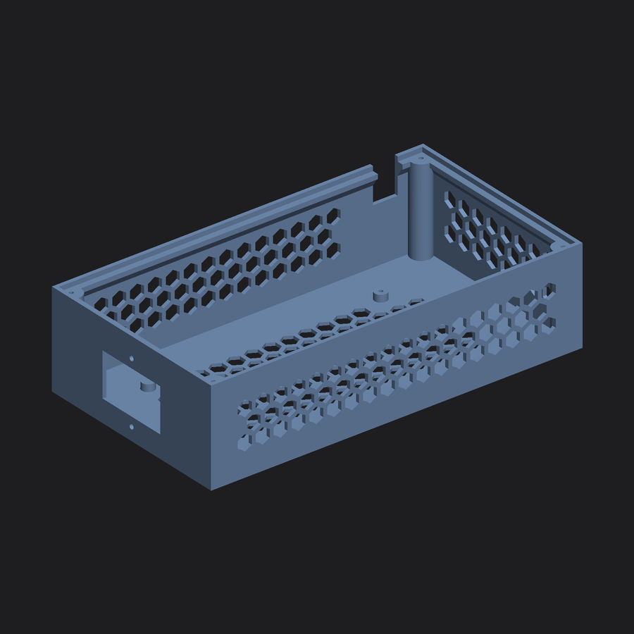
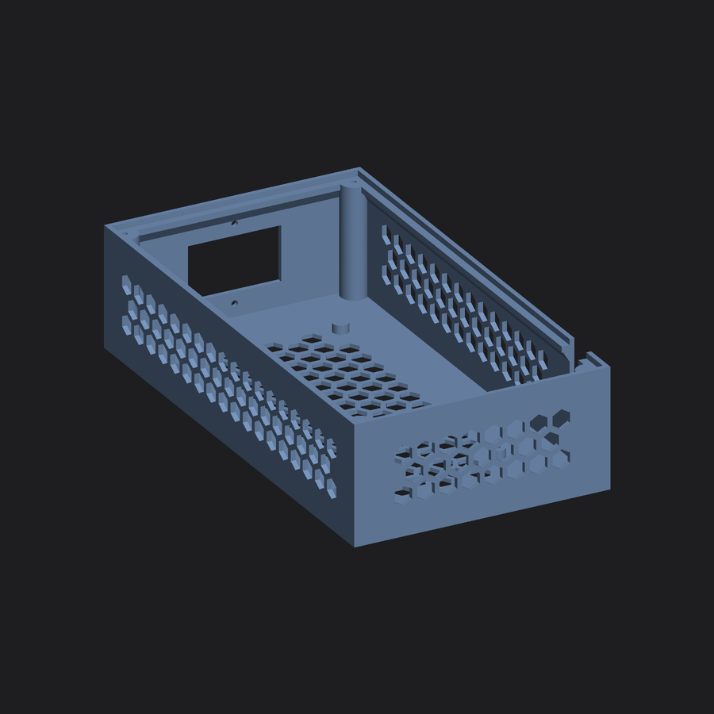

# PSU Enclosure — Auto Dialer

Vented enclosure for the Auto Dialer's mains power supply. It holds an Arcity-style
**160 × 98.5 × 39 mm** arcade switching PSU and a **screw-mount fused/switched IEC power inlet**,
with a removable honeycomb-vented lid. The low-voltage harness exits upward to the
[touchscreen case](../) through a lid-height notch, strain-relieved by a slip-in TPU grommet.

Generated parametrically with [build123d](https://github.com/gumyr/build123d) — see
`PSU-Case-generator.py` (deps: `build123d`, `numpy`; writes STL/STEP to the `OUT` path).

## Print these
- `PSU-Case-Body.stl` / `.step`
- `PSU-Case-Lid.stl` / `.step`
- `PSU-Case-Grommet.stl` / `.step` — **print in TPU** (cable strain relief)

## Design
- External **~241 × 131.5 × 61.5 mm**; internal 236 × 126.5 × 59; walls/floor 2.5 mm.
- **PSU mount:** sits on four 4 mm corner standoffs (airflow underneath), screwed down at its two
  diagonal holes (M3 self-tap into the standoffs). Post spacing **151 mm** long-way × **86.5 mm**
  short-way. Two plain support pads + low corner guides locate it.
- **IEC inlet:** screw-mount, on the −X end wall. Cutout **47.7 × 28.2 mm**, two M3 holes **40 mm**
  apart (vertical), centre 26 mm up.
- **Terminal access:** the PSU terminal block faces the **+X end**, which has a **38 mm (1.5")**
  access bay for spade connectors and wire routing — reachable without removing the inlet.
- **Lid:** recessed into a flanged rabbet, four full-height M3 corner posts (self-tapping). The
  cable notch (front wall, +X bay) is open to the top, so the harness drops in/out with the lid off.
- **Venting:** honeycomb on both long walls, the +X end, the floor, and the lid.

## Hardware
- PSU: Arcity 5V/12V/24V arcade PSU (160 × 98.5 × 39)
- Inlet: 15 A fused + switched IEC C14 inlet module (screw-mount, ~47 × 28 cutout)
- Screws: 4× M3 (lid), 2× M3 (PSU hold-down), 2× M3 (inlet)
- **PSU barrier strip:** #8-stud fork/spade terminals (gauge to suit your wire, e.g. 14 AWG = blue)
- **IEC inlet tabs:** 5 mm wide (NOT the usual 6.35 mm / .25"). Use **.187" (4.8 mm) flag disconnects
  — `FLDNY2-187`, blue / 16–14 AWG. Right-angle "flag" style is what the +X bay depth assumes.

## Cable grommet (TPU)

A slip-in TPU grommet strain-relieves the 3× 14 AWG harness where it exits the cable notch
(generated by `PSU-Case-Grommet-generator.py`).
- Drops into the open-top notch; a groove grips the wall on three sides and the lid traps the top.
- Three Ø4 mm wire holes with a **slit down the top** so the wires side-load (no threading).
- **Handed:** the two flanges differ — install with the **taller/wider flange facing OUT**. The
  inner flange is shorter (clears the lid ledge on the cavity side) with a smaller 2 mm overhang so
  it inserts more easily; the outer runs full height with 3 mm overhang for grip.
- **Print in TPU at ≤20% infill** so it stays flexible enough to insert and to grip the wires.
  Tune the Ø4 mm holes (`WD` in the generator) to your actual wire OD if needed.

## Print notes
- **Body:** open-top up. No supports needed except the **top of the inlet cutout** (one small
  bridge). The lid ledge is undercut with a ~58° self-supporting ramp and the corner posts are
  full-height, so neither needs support.
- **Lid:** flat, either side down.
- **Support threshold:** printed successfully on a Bambu X1 with the support threshold set to
  **10°** — that generates supports *only* at the inlet cutout and leaves everything else alone.
- **Bed fit (X1 / 256 × 256):** the body footprint is **241 × 131.5 mm**, leaving only ~7.5 mm per
  side in X. It fits, but **auto-arrange will refuse to place it** because of the edge margin it
  reserves. Place it manually — shifting it to one side of the bed leaves room for the inlet-cutout
  support to sit on the plate. The lid (235.4 × 125.9) is nearly as wide; **print the two parts
  separately**, they will not plate together.

## Wiring terminals (measured)
- **PSU barrier strip:** #8 screw studs → #8 fork/spade terminals.
- **IEC inlet:** 5 mm tabs → `FLDNY2-187` .187" flag disconnects (blue, 16–14 AWG). The usual
  .25" flags are too wide. The inlet's own pre-wired leads are 18 AWG; plan on **re-terminating
  them yourself** with the flags above.
- **Why flags:** clearance in the +X bay is tight even at 38 mm. Right-angle flag terminals turn
  the wire 90° so it runs along the terminal block instead of straight out — that is what the bay
  depth assumes. The alternatives (inlet on a side wall, or a taller case) waste far more volume
  for the same result.

## To confirm before final assembly
- Test-fit the flag terminals + wire bend in the +X bay before final wiring.
- Re-slice the STLs (any previously bundled `.3mf` is stale).
