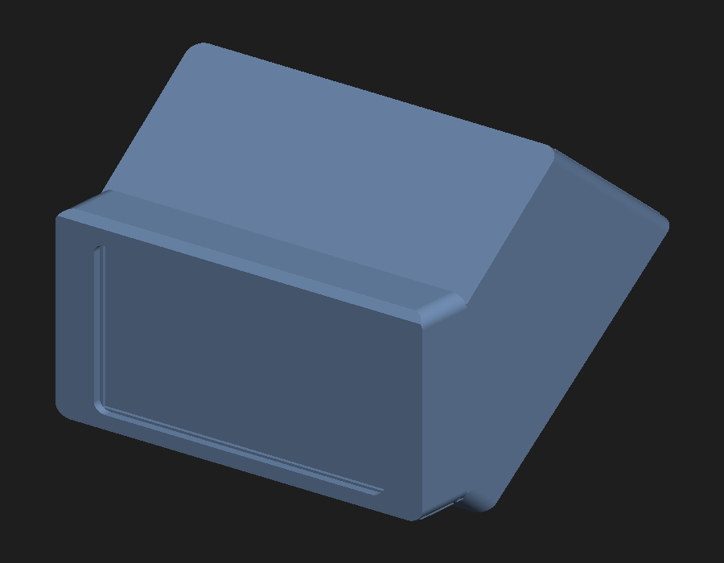
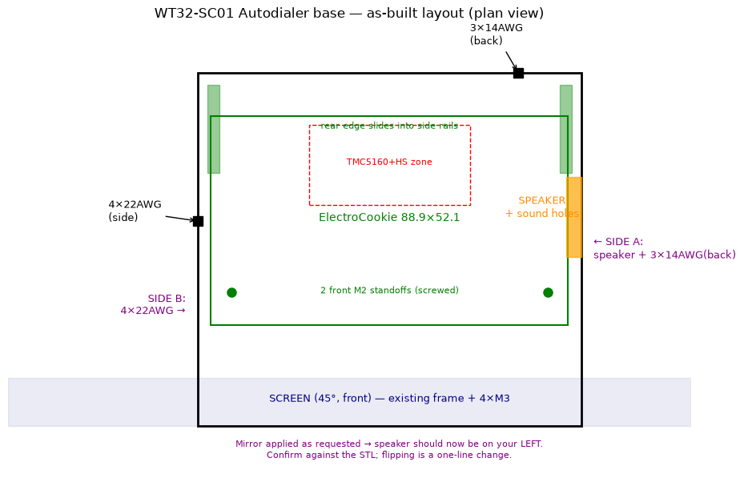

# WT32-SC01 Plus Touchscreen Case

A desk enclosure for the **touchscreen build** of the Auto Dialer. It holds the
WT32-SC01 Plus display at a 45° viewing angle and houses an internal perfboard carrying the
TMC5160 stepper driver (with heatsinks), a 5 V→3.3 V regulator, a small speaker, and the field
wiring — all inside one enclosed, desk-friendly wedge.

Inspired by the [Desk enclosure for WT32-SC01](https://www.printables.com/model/322687-desk-enclosure-for-wt32-sc01)
on Printables. This version is substantially redesigned: enlarged to fit the perfboard +
driver/heatsink with airflow clearance, a removable back panel, relocated cable exits and speaker
vent, and a newly generated front bezel matched to the caliper-verified screen dimensions.



## Parts to print

| File | What it is |
|------|-----------|
| `WT32-SC01-Base-Autodialer.stl` / `.step` | Main body (screen at 45°, flat desk foot, open back) |
| `WT32-SC01-Frame-Autodialer.stl` / `.step` | Front bezel that wraps the screen |
| `WT32-SC01-BackPanel-Autodialer.stl` / `.step` | Removable back panel — **closed** cable slot |
| `WT32-SC01-BackPanel-OpenSlot-Autodialer.stl` / `.step` | Same panel, cable slot **open to the edge** so it slides off the wire bundle without disconnecting. Print **one** back panel or the other. |

Print orientation: **body** screen-face-down (open back up); **bezel** face-down (collars/walls up,
no supports); **panel** flat. PETG/ABS is a good idea near the driver for heat tolerance.

## Hardware / parts list

Specific to this touchscreen case (in addition to the mechanical parts below):

- **WT32-SC01 Plus** 3.5" touchscreen — https://www.seeedstudio.com/WT32-3-5-Inch-Display-p-5542.html
- **ElectroCookie Proto-Board 3.5"×2"** (88.9 × 52.1 mm perfboard) — https://amzn.to/4wMaTIr
- **Mini Oval Speaker** (Adafruit 3923) — https://www.adafruit.com/product/3923
- **8-pin PicoBlade cable** (Adafruit 4928) — https://www.adafruit.com/product/4928
- **5 V → 3.3 V regulator** — https://amzn.to/4vGqHvz
- **Heatsinks for the stepper driver** (4×) — https://amzn.to/4hrIzGO
- **Screws** (https://amzn.to/4f9Nn2e):
  - 4× **M3×16** — attach the bezel + screen to the case
  - 4× **M3×6** — back panel to the case
  - 2× **M2×8** — perfboard to the case

All other parts are listed in **[Jared's original Auto Dialer Bill of Materials](../../README.md#bill-of-materials)**
and still apply — **except the ESP32-S3**, which is replaced by the WT32-SC01 Plus above.

## Screen + front bezel

The screen (92 × 60 mm module, with its own Ø2.3 threaded mount ears on a 75.14 × 51.39 mm pattern)
bolts **directly** to the base: the 4× M3×16 come from inside the case and self-tap into the
screen's ears. The bezel is **clamped by those same screws** — it has 4 collars (Ø3.5 clearance)
that the screws pass through into the screen ears, so the screen stands ~2 mm off the base face and
the bezel is trapped between screen-back and base-face. No separate bezel screws.

The bezel wraps the screen on the sides and **top** (closed top cap, chamfered to blend into the
roofline); the **bottom is open** so the screen slides up into the pocket and the ribbon/connectors
exit downward into the cavity. The window shows the 74.04 × 49.56 mm active area. The bezel collars
are braced (top collars to the top cap, bottom collars via a curved taper gusset) so they don't flex.

## Removable back panel

The 4× M3 screen-screw heads sit on the cavity side, so the enclosure is assembled through an open
back and then closed with a screw-on panel (4× M3×6 self-tapping into buttressed corner blocks that
tie each screw into the side wall + roof/floor + ledge). This also gives full access to service the
board later.

## Cabling & speaker



- Wire slots sit **above** the board top so wires drop straight into the top-mounted screw terminals.
- **3× 14 AWG** power/field wiring: rounded slot in the back panel, near a corner.
- **4× 22 AWG** signal wiring: rounded slot in one side wall.
- **Speaker** sits on the bottom floor **under** the perfboard, firing down through a centered vent
  grid. Because it fires toward the desk, set the case on a soft surface (or add small bumper feet)
  so the sound isn't muffled.

## Board bay

Flat board bay: the perfboard rests on 2 front M2 self-tap standoffs (Ø1.7 pilot) with its rear edge
captured in side-wall rails; it loads in through the open back. The board sits ~16 mm above the desk,
and the rear-center zone over the driver keeps ≥24 mm of clearance to the roof for the heatsink and
airflow. The 2 front standoffs and the 4 screen bosses are each gusseted to the nearest side wall so
they don't snap.

## Key dimensions

- Body outer ≈ 95.6 W × 88 D × ~70 H mm, screen face at 45°, ~2.4 mm walls.
- Screen interface (WT32-SC01 Plus / ZX-350, from the caliper-verified datasheet drawing): 92 × 60 mm
  module; 4× M3 mount holes on a **75.14 × 51.39 mm** pattern — horizontally asymmetric (front-view
  margins 10.34 mm left / 6.52 mm right), vertically centered. Base holes are Ø3 clearance with a
  Ø5.5 head counterbore on the cavity side.
- Back panel 2.5 mm, sits flush in a recess.

## Regenerating / editing the models

The parts are built parametrically in Python with **[build123d](https://build123d.readthedocs.io/)**
(an OpenCASCADE-based CAD kernel), so the geometry can be re-derived or tweaked from source rather
than mesh-edited.

- `WT32-SC01-Base-generator.py` — builds the base + both back-panel variants.
- `WT32-SC01-Frame-generator.py` — builds the front bezel.

**Dependencies:** Python 3.10+ and:

```
pip install build123d numpy
```

Each script exports both STL and STEP. They write to the working directory set by the `OUT = r"..."`
line near the top (currently `C:\scratchpad`) — edit that path for your machine, then run:

```
python WT32-SC01-Base-generator.py
python WT32-SC01-Frame-generator.py
```

Notes for editing:
- Handedness (which wall the speaker / 14 AWG / 22 AWG land on) is controlled by the `MIRROR` flag in
  the base generator — flip it to mirror the whole body + panels.
- **Confirm the screw-pattern asymmetry direction against your physical screen before printing.** As
  built, the 10.34 mm margin is on the front-view left. A 180° screen rotation swaps it (the pattern
  is vertically symmetric), or adjust the screw-margin parameters in the base generator.

## License

Part of the Dygert-Locksport Auto Dialer project — see the repository
[LICENSE](../../LICENSE) (PolyForm Noncommercial License 1.0.0).
